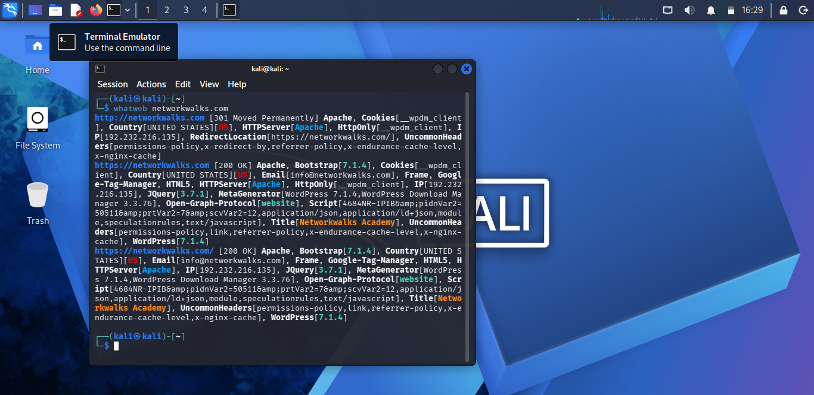
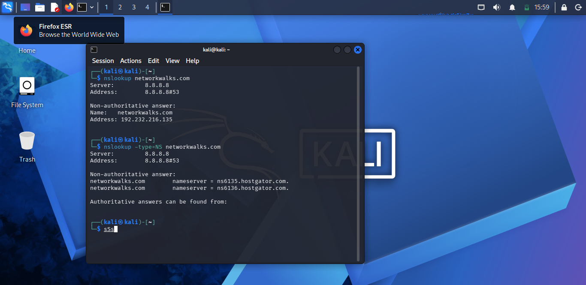
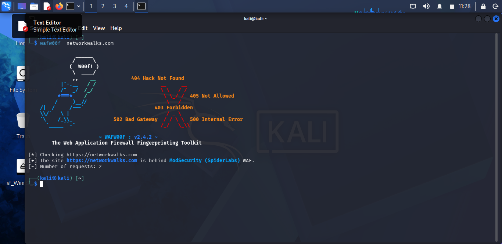

# PENETRATION TESTING REPORT

### Footprinting & Network Scanning Phases

**W2-PM-FINAL | CYBERSECURITY | B084**

| **Field** | **Detail** |
|---|---|
| **Pentester Name (Cybersecurity Professional)** | Fizza Mushtaq |
| **Program/Batch** | B084-NETWORKWALKS |
| Intern Id | NW-084-347 |
| **Date** | 13 November 2026 |
| **Modules Completed** | W2-PM1 (Multiple Kali Tools)    W2-PM5 (Zenmap Scanning) |
| **Client/Target** | 1. `networkwalks.com` (domain-related observations)   2. My own local virtual network |
| **Phases Covered** | **Phase 1:** Reconnaissance & Footprinting   **Phase 2:** Scanning & Network Discovery |

# 1. Liability Disclaimer

I have performed these activities for educational and research purposes. Local network scanning and lab-based exercises were conducted in my own virtual environment. Domain-related observations are documented as practical results and should not be interpreted as confirmation of written authorization for further testing.

These materials are intended for educational purposes only. The instructor, authors, and Networkwalks are not responsible for any misuse of the information presented in this report. Every action taken using this knowledge is the responsibility of the individual. Unauthorized access or testing against systems without appropriate permission may have legal consequences.

# 2. Introduction

This report covers footprinting and reconnaissance of the `networkwalks.com` domain using multiple Kali Linux tools (W2-PM1) and scanning my own local virtual network using Zenmap (W2-PM5).

The first module focuses on gathering publicly available domain information and identifying web technologies, while the second focuses on discovering active hosts, examining network information, and generating a network topology.

Together, these activities demonstrate two important stages of penetration testing: reconnaissance and network discovery. This report represents the Week 2 practical work completed as part of my Cybersecurity Internship at Networkwalks.

All practical activities were performed using Kali Linux, including Zenmap running inside a Kali Linux virtual machine in VirtualBox. Each activity was documented with its command, observed results, screenshots, and relevant findings.

# 3. Tools Used

The following tools were used during the practical activities.

| **Tool** | **Purpose** |
|---|---|
| Kali Linux | Operating system used for the practical activities |
| WHOIS | Retrieve domain registration details, registrar information, dates, and name servers. |
| WhatWeb | Fingerprint web technologies, server details, CMS, and plugins. |
| Nslookup | Resolve domain names and retrieve DNS information. |
| Dig | Query different DNS record types and perform DNS tracing. |
| cURL | Inspect HTTP response headers. |
| WAFW00F | Detect whether a Web Application Firewall protects a website. |
| DNSRecon | Perform DNS enumeration. |
| Zenmap (Nmap GUI) | Discover live hosts and visualize network topology. |
| ARP Scan | Identify devices and investigate MAC addresses on the local network. |

# 4. Activities Performed

## 4.1 Footprinting & Reconnaissance

I performed footprinting and reconnaissance activities involving the `networkwalks.com` domain using multiple Kali Linux tools: **WHOIS, WhatWeb, Nslookup, Dig, cURL, WAFW00F, and DNSRecon**.

Each tool was used to collect or analyze a different type of information.

First, I used **WHOIS** to obtain publicly available domain registration information. The results provided details about the registrar, registration and expiration dates, domain status, and name servers. The registrant information was protected through a domain privacy service.

I then used **WhatWeb** to identify the technologies used by the website. The results identified Apache as the web server and WordPress 7.1.4 as the CMS. Other detected technologies included Bootstrap 7.1.4, jQuery 3.7.1, and WordPress Download Manager 3.3.76.

Using **Nslookup**, I resolved the domain name and identified its IP address as `192.232.216.135`. The name server records also identified the domain's configured DNS servers.

I used **Dig** to query different DNS record types, including A, MX, TXT, SOA, AAAA, and CAA. I also performed a DNS trace to observe the DNS resolution process from the root servers to the authoritative name servers.

For **cURL**, I used the `-I` option to inspect HTTP response headers. This activity was demonstrated using a local Kali Linux HTTP server rather than the external website.

Next, I used **WAFW00F** to identify whether a Web Application Firewall was protecting the website. The tool reported **ModSecurity (SpiderLabs)** as the detected WAF and completed the detection process after making two requests.

Finally, I used **DNSRecon** to demonstrate DNS enumeration against a locally configured test domain, `lab.test`. The local DNS environment was configured using dnsmasq, and DNSRecon successfully identified the A record pointing to `127.0.0.1`. No external DNSRecon enumeration was performed.

**Scope Note:** Domain-related observations and local laboratory exercises are documented separately. The cURL and DNSRecon demonstrations were conducted in the local lab environment.

## 4.2 Network Scanning with Zenmap

For the second activity, I used **Zenmap** to perform network discovery on my local virtual network. The practical required identifying the local IP address and subnet, discovering live hosts, investigating IP and MAC addresses, and generating a network topology.

Zenmap was launched inside a Kali Linux virtual machine running in VirtualBox.

I first used the `ip -4 addr` command to identify the network interface and local IP configuration.

The identified network configuration was:

| **Parameter** | **Result** |
|---|---|
| Network Interface | eth0 |
| Local IP Address | `10.0.0.2` |
| Subnet | `10.0.0.0/24` |
| Broadcast Address | `10.0.0.255` |

I then performed a **Ping Scan** against the local subnet `10.0.0.0/24` to identify active hosts.

The scan covered 256 IP addresses and identified three active hosts:

- `10.0.0.1`
- `10.0.0.2`
- `10.0.0.3`

An additional **Quick Scan** was performed against `127.0.0.1`. The scan identified 100 TCP ports, with one open port: `53/tcp` (DNS). The remaining 99 ports were closed.

I also used the `ip link show eth0` command to identify the MAC address of the Kali network interface. An additional ARP scan was performed to investigate the MAC addresses associated with the discovered local hosts.

During the ARP scan, a duplicate/conflicting response was observed for `10.0.0.2`. Therefore, the MAC address results were documented carefully, without assuming that the conflicting result represented the confirmed MAC address of the Kali interface.

Finally, I opened the **Topology** section in Zenmap to visualize the discovered hosts. The topology was exported in PNG and PDF formats, and the scan results were saved in XML format.

**Environment Note:** The practical was completed using Zenmap inside Kali Linux in VirtualBox rather than installing Zenmap directly on a Windows PC.

# 5. Risk Analysis / Impact

Based on the information collected during the footprinting and network scanning activities, I identified the following potential security considerations.

| **#** | **Risk / Finding** | **Evidence / Observation** | **Potential Impact** | **Risk Level** |
|---|---|---|---|---|
| 1 | Web technology information exposed | WhatWeb identified Apache, WordPress, and related technologies. | Technology and version information may help an attacker identify software requiring further security review. | **● Medium** |
| 2 | Server IP address identifiable | Nslookup resolved the domain to `192.232.216.135`. | Provides information about the network location of the web service. | **● Low** |
| 3 | DNS infrastructure information exposed | Dig queries returned DNS records and name server information. | Public DNS information can help build a broader infrastructure profile. | **● Low** |
| 4 | WAF technology identifiable | WAFW00F reported ModSecurity (SpiderLabs). | Reveals information about the website's security infrastructure. | **● Low** |
| 5 | Local network hosts discoverable | Zenmap identified three active hosts on the local subnet. | Unknown or unauthorized devices on a network may require investigation. | **● Medium** |
| 6 | Conflicting ARP response observed | ARP Scan returned duplicate/conflicting MAC information for `10.0.0.2`. | Incorrect device identification may affect network inventory and troubleshooting. | **● Low** |

**Risk level key:** ● Critical  ● Medium  ● Low

The risks listed above are observations from the footprinting and network discovery exercises, not confirmed vulnerabilities.

These practical activities primarily involved information gathering, technology identification, DNS analysis, and host discovery. No exploitation or vulnerability validation was performed.

The presence of information such as a software version, IP address, DNS record, or identifiable WAF does not by itself establish that a system is vulnerable. Further authorized security testing would be required to confirm any actual vulnerability.

# 6. Recommendations

Based on the observations from these activities, I recommend the following security improvements:

1. **Review publicly exposed technology information**  
   Organizations should regularly review the information exposed about their web servers, CMS platforms, and plugins.

2. **Keep software updated**  
   CMS platforms, plugins, and other web technologies should be regularly updated and reviewed against current security advisories.

3. **Review HTTP response headers**  
   HTTP response headers should be reviewed to determine whether unnecessary technical information is being exposed.

4. **Review DNS records regularly**  
   DNS records should be checked periodically to ensure that only required information and services are publicly exposed.

5. **Properly configure and monitor the WAF**  
   Organizations should keep their Web Application Firewall properly configured, updated, and monitored to help protect web applications against malicious requests.

6. **Perform regular internal network discovery**  
   Organizations should periodically scan their own networks to identify active devices and maintain an updated network inventory.

7. **Investigate unknown devices**  
   Unexpected devices discovered during network scanning should be investigated and verified.

8. **Maintain network documentation**  
   Network topology, device information, and IP address assignments should be documented and updated regularly.

9. **Perform security testing with authorization**  
   Reconnaissance and scanning should only be performed against systems and networks where appropriate authorization has been provided.

# 7. Conclusion

During Week 2 of my Cybersecurity Internship, I completed practical activities covering footprinting, reconnaissance, and network scanning.

In the footprinting activity, I used multiple Kali Linux tools to collect and analyze domain information. I learned how WHOIS provides domain registration details, WhatWeb identifies web technologies, Nslookup and Dig retrieve DNS information, cURL inspects HTTP response headers, WAFW00F identifies Web Application Firewalls, and DNSRecon performs DNS enumeration.

In the network scanning activity, I used Zenmap to identify my local network configuration and discover active hosts. I also investigated IP and MAC address information, performed a Quick Scan, and generated a network topology.

These exercises helped me understand that information gathering and network discovery are important foundations of cybersecurity. They demonstrated how technical information can be collected, analyzed, and documented before moving towards further security assessment.

I also learned the importance of accurate technical reporting. A good cybersecurity report should explain the activities performed, the results obtained, the limitations encountered, and the potential security implications of the findings.

Finally, these practical exercises reinforced the importance of conducting cybersecurity testing within an appropriate and authorized scope.

# 8. Evidences Collected
Screenshots and supporting files collected during the practical activities are organized in the repository.

### WHOIS Lookup

### WhatWeb Fingerprinting

### Nslookup DNS Enumeration

### cURL HTTP Headers

### WAF Detection

### Zenmap Ping Scan

### Zenmap Network Topology

The evidence includes:

**Footprinting & Reconnaissance — W2-PM1**
- WHOIS output
- WhatWeb output
- Nslookup results
- Dig DNS query results
- cURL HTTP response headers from the local Kali server
- WAFW00F detection output
- DNSRecon local lab output

**Network Scanning — W2-PM5**
- Zenmap Quick Scan
- Zenmap Ping Scan
- Live host discovery results
- Host details
- IP and MAC address investigation
- ARP Scan output
- Network topology screenshot, including the legend

**Additional Deliverables**
- Zenmap scan results in XML format
- Network topology in PNG format
- Network topology exported in PDF format
- Week 2 commands and terminal outputs text file

---

**End of Report**
